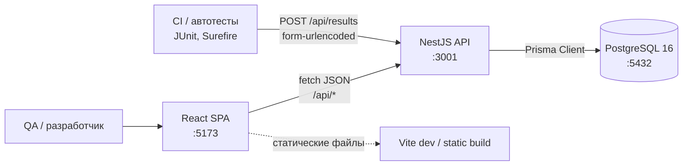
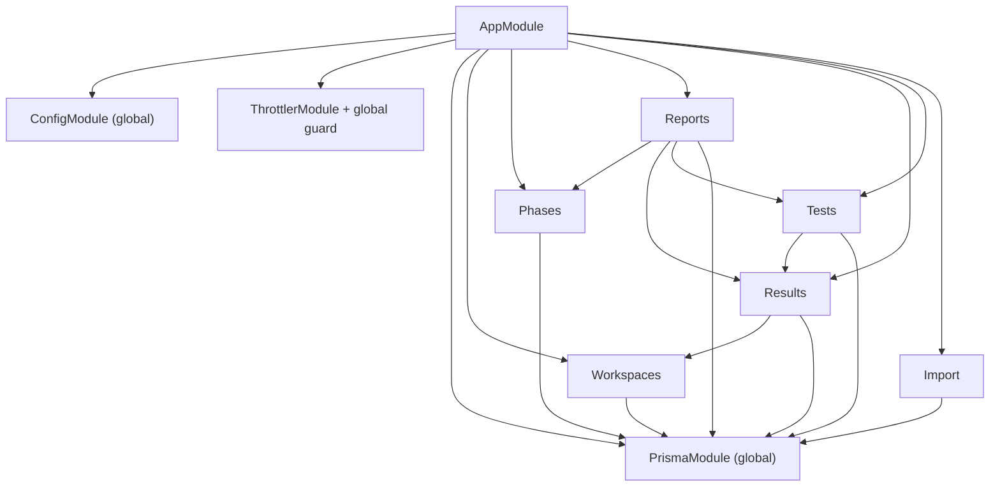
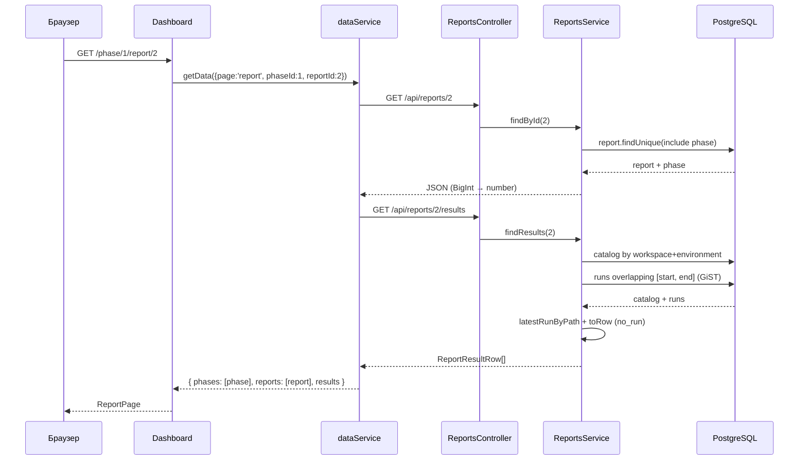
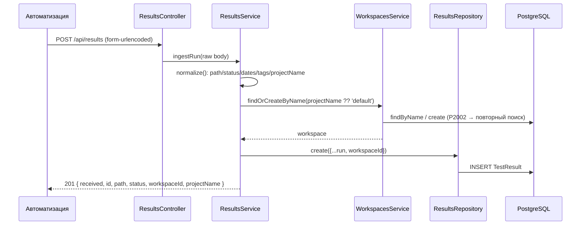

# 02. Архитектура

## Общая картина



Приложение состоит из двух независимых приложений и одной БД:

| Компонент | Расположение | Запуск | Ответственность |
| --- | --- | --- | --- |
| SPA | `src/` | `npm run dev` (Vite, :5173) | UI, ручной роутинг, вызовы API, клиентская аналитика |
| API | `api/src/` | `npm run api:dev` (Nest, :3001) | валидация, бизнес-логика, доступ к БД |
| БД | Docker Compose | `npm run db:up` | хранение, ограничения целостности, индексы |

Сборка фронтенда (`vite build`) кладёт статику в `dist/`; API собирается `nest build` в
`api/dist/` и запускается `node dist/main.js`. Отдельного Dockerfile для приложений нет — контейнером
поставляется только PostgreSQL.

## Frontend: слои и поток данных

```text
index.html
└── src/main.jsx                 React.StrictMode + createRoot
    └── src/App.jsx              ConfigProvider (antd theme) + AntApp + ручной роутер
        └── pages/Dashboard.jsx  загрузка данных, обработка ошибок, выбор страницы
            ├── components/Shell.jsx        каркас: сайдбар, workspace switcher, тема
            ├── pages/PhasesPage.jsx        список фаз
            ├── pages/ReportsPage.jsx       отчёты фазы + сводный график
            ├── pages/ReportPage.jsx        результаты отчёта
            └── pages/ReportDashboard.jsx   аналитика отчёта
```

Правила:

- **Единственная точка доступа к API** — `src/services/dataService.js`; компоненты не вызывают
  `fetch` напрямую.
- **Маршрутизация ручная**: `App.jsx` парсит `window.location.pathname`, `navigate()` делает
  `history.pushState`, подписка на `popstate` возвращает состояние при кнопках браузера.
  `react-router` не используется.
- **Данные страницы загружаются в `Dashboard`** одним вызовом `getData(route)`, после чего
  передаются странице как prop `data`. Страница не знает, откуда пришли данные.
- **Загрузка зависит от маршрута** (route-level fetch): список фаз, отчёты фазы и результаты
  отчёта запрашиваются разными наборами эндпоинтов; лишние данные не грузятся.
- **Тема** хранится в `localStorage` и применяется двумя способами: токены antd `ConfigProvider`
  и CSS-переменные `:root[data-theme]`.

Подробности — [03-frontend.md](03-frontend.md).

## Backend: слоистая архитектура

API следует слоистой схеме, вдохновлённой Spring Boot, но остаётся модульным NestJS-приложением:

```text
api/src/
├── main.ts                     bootstrap: префикс /api, BigInt→Number, парсеры, CORS, pipes
├── app.module.ts               корневой модуль: config, throttler, Prisma, фичи
├── config/app.config.ts        типизированная конфигурация из env
├── common/
│   ├── database/               PrismaModule (global) + PrismaService
│   └── pipes/                  ParseBigIntPipe
└── modules/
    ├── workspaces/  controller → service → repository → Prisma
    ├── phases/      controller → service → repository → Prisma
    ├── reports/     controller(s) → service → repository → Prisma (+ PhasesService, ResultsRepository, TestsRepository)
    ├── results/     controller → service → repository → Prisma (+ WorkspacesService)
    ├── tests/       controller → service → repository → Prisma (+ ResultsRepository)
    └── import/      controller → service → repository → Prisma
```

Правила слоёв:

| Слой | Где | Можно | Нельзя |
| --- | --- | --- | --- |
| Controller | `controller/*.ts` | HTTP-декораторы, параметры, вызов сервиса | обращаться к Prisma, содержать бизнес-правила |
| Service | `service/*.ts` | валидация бизнес-правил, оркестрация, доменные вычисления | формировать SQL/Prisma-запросы |
| Repository | `repository/*.ts` | Prisma-запросы, транзакции | HTTP-исключения, знание DTO-валидации |
| DTO | `dto/*.ts` | `class-validator`-декораторы, типы контракта | логика доступа к данным |
| Module | `*.module.ts` | сборка providers/controllers, импорты | — |

### Граф модулей



- `WorkspacesModule` экспортирует `WorkspacesService` — его использует приём запусков
  (автосоздание workspace).
- `ResultsModule` экспортирует `ResultsService` и `ResultsRepository` — репозиторий нужен отчётам
  (выборка запусков по окну) и каталогу (Harvest).
- `TestsModule` экспортирует `TestsService` и `TestsRepository` — каталог нужен отчётам.
- `ReportsModule` импортирует `PhasesModule` (проверка существования фазы и границ периода).

### Поток «открыть отчёт»



## Приём запуска



Дубликаты запусков не отсекаются: повторный POST создаёт новую строку (это осознанно — один и тот
же тест может запускаться многократно). Идемпотентны только операции каталога (upsert по
`(workspaceId, resultPath)`) и legacy-импорт (проверка `path + startDate`).

## Сквозные механизмы

| Механизм | Реализация | Комментарий |
| --- | --- | --- |
| Сериализация BigInt | `BigInt.prototype.toJSON = Number` в `main.ts` | все ID в JSON — числа |
| Валидация DTO | глобальный `ValidationPipe` (`whitelist`, `transform`, `forbidNonWhitelisted`) | неизвестные поля → `400` |
| Ручная валидация | `POST /api/results` без DTO | контракт внешний, лишние поля игнорируются |
| Ограничение частоты | `ThrottlerModule` + `ThrottlerGuard` глобально | переопределения на `results`, `harvest`, `import` |
| Ошибки | `NotFoundException` / `BadRequestException` Nest | Prisma `P2025` → `404`, `P2002` — обрабатывается точечно |
| Транзакции | `prisma.$transaction` в `harvestBatch`, `create` (каталог), `executeImport` | атомарность пакетных операций |
| CORS | `app.enableCors({ origin: CORS_ORIGIN })` | по умолчанию `http://localhost:5173` |
| Лимит тела | `json({ limit: '10mb' })`, `urlencoded({ limit: '10mb' })` | пакетная отправка результатов |

## Ключевые проектные решения

| Решение | Причина | Следствие |
| --- | --- | --- |
| Отчёт = окно дат, запуски не привязаны к отчёту | отчёт можно создать/удалить, не трогая данные; один запуск виден в нескольких отчётах | выборка по пересечению интервалов, GiST-индекс |
| Каталог как фильтр отчёта | в отчёт попадают только известные тесты, в том числе `no_run` | нужен Harvest/импорт; запуски без каталога невидимы в отчёте |
| `resultPath` — бизнес-ключ, а не ID | стабильная связь запусков и каталога при переимпорте | upsert, уникальность в рамках workspace |
| Workspace-скоупинг | несколько проектов в одной БД, изоляция данных | все выборки фильтруются по `workspaceId`; удаление workspace каскадно |
| Канонизация строк в БД (`lower`, `btrim`) | избежать расхождений при сравнении окружений и путей | CHECK-ограничения, индексы по точному равенству |
| `environment`/`circuit` как TEXT, а не enum | произвольные названия окружений | нормализация в коде и CHECK-констрейнты |
| BigInt-ключи | рост данных, стабильные числовые ID | ограничение точности при экспорте в JS (см. ниже) |
| Отдельная таблица `AutomatedTestEnvironment` | тест может участвовать в нескольких окружениях | составной PK, каскад, GIN больше не нужен |
| Ручной роутинг на History API | минимальные зависимости, 4 экрана | нет вложенных layout-роутов и ленивой загрузки |

## Риски и технический долг архитектуры

- **Нет аутентификации**: API доверяет сети. Legacy-импорт защищён только флагом окружения и
  заголовком подтверждения.
- **BigInt → Number**: ID больше `2^53` потеряют точность при сериализации. Практически недостижимо
  при текущих объёмах, но ограничение стоит держать в голове.
- **Клиентская аналитика**: при большом отчёте вся агрегация выполняется в браузере.
- **`workspaceId` в клиенте** хранится в `localStorage`; при его отсутствии создание фазы/теста
  уйдёт с `workspaceId: null` и получит `400`. Выбор workspace — обязательный первый шаг.
- **Функциональность workspace ещё не закоммичена** (см. [09-code-index.md](09-code-index.md#состояние-репозитория)):
  `Workspace` уже есть в схеме, миграциях и API, а `master` содержит предыдущую версию.
- **Дублирование CSS**: `src/styles.css` содержит повторяющиеся блоки `:root` и стилей — правки
  нужно вносить в оба места либо провести чистку.
- **Порядок миграций**: см. предупреждение в [06-data-model.md](06-data-model.md#порядок-миграций).

## Связанные документы

- Контракты API — [05-api.md](05-api.md)
- Модель данных и индексы — [06-data-model.md](06-data-model.md)
- Приём данных и импорт — [07-ingestion-and-import.md](07-ingestion-and-import.md)
