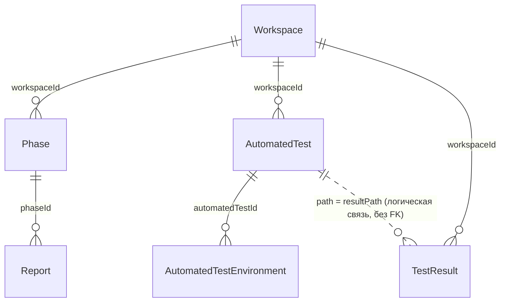

# 06. Модель данных

СУБД — PostgreSQL 16, схема описана в `api/prisma/schema.prisma`, изменения — в
`api/prisma/migrations/`.

## ER-диаграмма



Связи:

- Все сущности, кроме `AutomatedTestEnvironment`, имеют `workspaceId` и каскадно удаляются вместе
  с workspace.
- `Phase → Report` — каскадное удаление.
- `AutomatedTest → AutomatedTestEnvironment` — каскадное удаление.
- `TestResult` **не связан** ни с `Report`, ни с `AutomatedTest`: отчёт выбирает запуски по окну
  дат, а каталог сопоставляется по строковому `path = resultPath`. Это позволяет хранить запуски
  тестов, ещё не добавленных в каталог.

## Таблицы

### `Workspace`

| Колонка | Тип | Ограничения |
| --- | --- | --- |
| `id` | `BIGINT` | PK, autoincrement |
| `name` | `VARCHAR(200)` | NOT NULL, UNIQUE; каноническая форма: `lower(trim(...))` |
| `createdAt` | `TIMESTAMPTZ(3)` | NOT NULL, default `now()` |
| `updatedAt` | `TIMESTAMPTZ(3)` | NOT NULL, `@updatedAt` |

Индексы: `Workspace_name_key` (unique), `Workspace_createdAt_idx`.

Имя приходит из `projectName` запусков; при первом запуске нового проекта workspace создаётся
автоматически.

### `Phase`

| Колонка | Тип | Ограничения |
| --- | --- | --- |
| `id` | `BIGINT` | PK, autoincrement |
| `workspaceId` | `BIGINT` | NOT NULL, FK → `Workspace.id`, `ON DELETE CASCADE` |
| `name` | `VARCHAR(200)` | NOT NULL |
| `environment` | `TEXT` | NOT NULL; CHECK `environment = lower(btrim(environment))` |
| `startedAt` | `DATE` | NOT NULL |
| `endedAt` | `DATE` | NOT NULL |
| `createdAt` | `TIMESTAMPTZ(3)` | NOT NULL, default `now()` |
| `updatedAt` | `TIMESTAMPTZ(3)` | NOT NULL, `@updatedAt` |

Индексы: `Phase_createdAt_idx`, `Phase_workspaceId_idx`.
Ограничение `Phase_environment_lowercase_check` добавлено миграцией
`20261020000000_canonicalize_environment_and_paths`.

### `Report`

| Колонка | Тип | Ограничения |
| --- | --- | --- |
| `id` | `BIGINT` | PK, autoincrement |
| `phaseId` | `BIGINT` | NOT NULL, FK → `Phase.id`, `ON DELETE CASCADE` |
| `name` | `VARCHAR(200)` | NOT NULL; UNIQUE в паре с `phaseId` |
| `startDate` | `DATE` | NOT NULL |
| `endDate` | `DATE` | NOT NULL |
| `createdAt` | `TIMESTAMPTZ(3)` | NOT NULL, default `now()` |
| `updatedAt` | `TIMESTAMPTZ(3)` | NOT NULL, `@updatedAt` |
| `author` | `VARCHAR(120)` | NOT NULL, default `'You'` |

Индексы: `Report_phaseId_name_key` (unique), `Report_phaseId_createdAt_idx`,
`Report_phaseId_startDate_endDate_idx`.

Бизнес-правило «окно отчёта внутри периода фазы» проверяется в сервисе, а не в БД.

### `AutomatedTest`

| Колонка | Тип | Ограничения |
| --- | --- | --- |
| `id` | `BIGINT` | PK, autoincrement |
| `workspaceId` | `BIGINT` | NOT NULL, FK → `Workspace.id`, `ON DELETE CASCADE` |
| `resultPath` | `VARCHAR(300)` | NOT NULL; CHECK `resultPath = btrim(resultPath) AND resultPath <> ''`; UNIQUE с `workspaceId` |
| `fullResponsibility` | `VARCHAR(200)` | NULL |
| `defaultSuiteName` | `VARCHAR(200)` | NULL |
| `defaultCaseName` | `VARCHAR(300)` | NULL |
| `defaultOwner` | `VARCHAR(120)` | NULL |
| `tags` | `JSONB` | NOT NULL, default `'[]'` |
| `visible` | `BOOLEAN` | NOT NULL, default `true` |
| `source` | `VARCHAR(30)` | NOT NULL, default `'manual'` (`manual`, `file`, `harvested`) |
| `createdAt` / `updatedAt` | `TIMESTAMPTZ(3)` | NOT NULL |

Индексы: `AutomatedTest_workspaceId_resultPath_key` (unique).

### `AutomatedTestEnvironment`

| Колонка | Тип | Ограничения |
| --- | --- | --- |
| `automatedTestId` | `BIGINT` | FK → `AutomatedTest.id`, `ON DELETE CASCADE` |
| `environment` | `TEXT` | CHECK `environment = lower(btrim(environment)) AND environment <> ''` |

PK — составной `(automatedTestId, environment)`; индекс `AutomatedTestEnvironment_environment_idx`.
Таблица определяет, в каких окружениях тест участвует (какие фазы его видят).

### `TestResult`

| Колонка | Тип | Ограничения |
| --- | --- | --- |
| `id` | `BIGINT` | PK, autoincrement |
| `workspaceId` | `BIGINT` | NOT NULL, FK → `Workspace.id`, `ON DELETE CASCADE` |
| `projectName` | `VARCHAR(200)` | NOT NULL; каноническая форма `projectName` запуска |
| `path` | `VARCHAR(300)` | NOT NULL; CHECK `path = btrim(path) AND path <> ''` |
| `suiteName` | `VARCHAR(200)` | NULL |
| `caseName` | `VARCHAR(300)` | NULL |
| `status` | `TestStatus` | NOT NULL (`passed`, `failed`, `broken`, `skipped`) |
| `owner` | `VARCHAR(120)` | NULL |
| `circuit` | `VARCHAR(120)` | NULL; CHECK `circuit IS NULL OR circuit = lower(circuit)` |
| `message` | `TEXT` | NULL |
| `failureReason` | `VARCHAR(120)` | NULL |
| `failureComment` | `TEXT` | NULL |
| `startDate` / `endDate` | `TIMESTAMPTZ(3)` | NOT NULL |
| `tags` | `JSONB` | NOT NULL, default `'[]'` |
| `createdAt` / `updatedAt` | `TIMESTAMPTZ(3)` | NOT NULL |

Индексы:

| Индекс | Назначение |
| --- | --- |
| `TestResult_workspaceId_path_startDate_idx` | история запусков по пути |
| `TestResult_workspaceId_startDate_endDate_idx` | диапазонные выборки |
| `TestResult_workspaceId_circuit_idx` | точное совпадение окружения (btree) |
| `TestResult_period_overlap_gist_idx` | `GIST (tstzrange("startDate","endDate",'[]'))` — пересечение интервалов |

Индекс GiST объявлен **только в миграции** (`20261020030000_gist_overlap_index`), его нет в
`schema.prisma`. Prisma не управляет такими индексами; при генерации новых миграций проверяйте,
что он не удаляется (`prisma migrate diff`).

## Инварианты

1. **Канонические строки.** `Phase.environment`, `TestResult.circuit`,
   `AutomatedTestEnvironment.environment`, `TestResult.path`, `AutomatedTest.resultPath`
   хранятся в нижнем регистре и/или обрезанными по краям; CHECK-ограничения не дают записать
   неканонические значения в обход приложения.
2. **Уникальность.**
   - workspace name — глобально;
   - `(workspaceId, resultPath)` — в каталоге;
   - `(phaseId, name)` — у отчётов;
   - `(automatedTestId, environment)` — членство.
3. **Ссылочная целостность.** Удаление workspace удаляет всё; удаление фазы — её отчёты; удаление
   каталога — его членства. Запуски не удаляются ни при удалении фазы, ни при удалении отчёта.
4. **Логическая связь запуск ↔ каталог** по `path = resultPath` и одному workspace; FK нет
   намеренно, чтобы принимать запуски до регистрации теста.
5. **Нет идемпотентности запусков**: `POST /results` всегда создаёт новую строку; одинаковые
   `path + startDate` допускаются (в отличие от legacy-импорта, который их пропускает).

## Алгоритм сопоставления отчёта и запусков

Вход: `report` (с фазой), `environment = trim(report.phase.environment)`, окно
`[dayStart(report.startDate), dayEnd(report.endDate)]`, где `dayEnd = 23:59:59.999 UTC`.

1. Каталог: `AutomatedTest` этого workspace, у которого есть членство в `environment`.
2. Запуски: `TestResult` этого workspace, у которых `tstzrange(startDate, endDate, '[]')`
   пересекается с окном, и `circuit = environment` (точное совпадение, оба в нижнем регистре).
   Сортировка `startDate DESC`.
3. Скрытые записи каталога (`visible = false`) отбрасываются.
4. Для каждого `path` выбирается одна строка:
   - самый поздний запуск;
   - если он не `passed`, но в окне есть более ранний `passed` — показывается последний `passed`.
5. Строка отчёта собирается из каталога и запуска: значения запуска приоритетны; отсутствие
   запуска → `status = 'no_run'`, `startDate/endDate/durationMs = null`.
6. `durationMs = max(0, endDate - startDate)`.

Это же правило используется в `results-summary` для подсчёта статусов по каждому отчёту фазы
(без построения строк).

> Из-за правила 4 отчет может показать `passed`, хотя последний прогон упал. Это осознанное
> решение (коммит «Prefer earliest passing run over later failures in report view»), но комментарий
> в `scripts/send-test-runs.ps1` («должен победить более поздний broken») ему противоречит — верьте
> реализации и этому документу.

## Идентификаторы

- Все ключи — `BIGINT` с автоинкрементом: `Phase`/`Report` через последовательности (`SERIAL` →
  `BIGINT`), `AutomatedTest`/`TestResult` — через `GENERATED BY DEFAULT AS IDENTITY`; в самых ранних
  версиях использовались CUID-строки.
- В JSON `BigInt` превращается в `Number` (глобальный `toJSON`).
- Точность `Number` — до `2^53 - 1` (≈ 9·10^15). При текущих объёмах недостижимо, но при экспорте
  больших ID возможна потеря точности; при необходимости возвращайте ID строками.

## История миграций

Порядок — лексикографический по имени каталога.

| Миграция | Что делает |
| --- | --- |
| `20260501000000_init` | начальная схема: enum `Environment`, `TestStatus` (с `running`), `Phase`, `Report`, `TestResult` с `steps`, привязкой к отчёту и FK |
| `20261013104649_add_automated_tests` | первая версия каталога (`name`, `description`, `suite`) |
| `20261013110000_automated_tests_external_id` | `automatedTestId`, уникальность вместо `name` |
| `20261013120000_automation_contract` | новый контракт: `broken` вместо `running`; `TestResult` — самостоятельный запуск без FK на отчёт; каталог по `resultPath` |
| `20261013130000_add_failure_feedback` | добавляет `TestResult.failureReason`, `failureComment` (после пересоздания таблицы; `IF NOT EXISTS`) |
| `20261013200000_automated_tests_visible_flag` | флаг `visible` |
| `20261013210000_report_integer_id` | `Report.id` → autoincrement integer, перенумерация |
| `20261013220000_remove_automated_test_display` | `display` → `defaultCaseName`, удаление колонки |
| `20261013230000_report_date_range` | `Report.startDate/endDate` + индекс |
| `20261014090000_environment_as_string` | `environment` из enum в `TEXT` |
| `20261014100000_bigint_autoincrement_ids` | все ID → `BIGINT` |
| `20261015120000_catalog_environment` | временная `AutomatedTest.environments TEXT[]` + GIN |
| `20261016120000_normalize_test_environments` | нормализация в `AutomatedTestEnvironment`, CHECK нижнего регистра |
| `20261020000000_canonicalize_environment_and_paths` | канонизация окружений/путей, CHECK-ограничения, индекс `circuit` |
| `20261020010000_report_unique_name_per_phase` | переименование дублей и `UNIQUE(phaseId, name)` |
| `20261020020000_add_updated_at` | `updatedAt` в `Phase`, `Report`, `TestResult` |
| `20261020030000_gist_overlap_index` | GiST-индекс по `tstzrange(startDate, endDate)` |
| `20261021000000_workspaces` | `Workspace`, сквозной `workspaceId`, `projectName`, FK, скоуп-индексы |

### Порядок миграций

Ранее миграция с полями `failureReason`/`failureComment` была датирована `20260309000000` — раньше
`init`, хотя изменяет таблицу, создаваемую в `init`. Prisma применяет миграции в лексикографическом
порядке, поэтому на чистой БД `prisma migrate deploy` падал с `P3018` («отношение TestResult не
существует»). Дополнительно `20261013120000_automation_contract` пересоздаёт `TestResult`, так что
добавление колонок сразу после `init` всё равно потерялось бы.

Исправление:

- каталог переименован в `20261013130000_add_failure_feedback` — сразу после `automation_contract`;
- SQL использует `ADD COLUMN IF NOT EXISTS`, поэтому миграция безопасна и для БД, где старая
  версия уже была применена;
- проверено на пустой БД: `prisma migrate deploy` и `prisma db seed` проходят.

Что делать с существующими БД:

- если старая миграция уже применена, новая применится как no-op — ручные действия не нужны;
- запись старого имени (`20260309000000_add_failure_feedback`) остаётся в `_prisma_migrations`,
  `migrate deploy` она не мешает;
- если в `_prisma_migrations` есть **неудачная** миграция (`finished_at IS NULL`, ошибка `P3009`),
  устраните причину и выполните `cd api && npx prisma migrate resolve --rolled-back <migration_name>`,
  затем повторите deploy.

Других нарушений порядка нет; остальные миграции идут по возрастанию и согласованы со схемой.

## Сиды

`api/prisma/seed.ts` (запуск: `npm --prefix api run prisma:seed`) идемпотентно создаёт:

- workspace `default`;
- 3 фазы: `Release 2.4.0` (stage), `Nightly regression · 17 Apr` (test),
  `Payments hotfix` (production);
- 4 отчёта с окнами, совпадающими с датами фаз;
- 5 записей каталога (одна скрыта — `CsvExportTest`);
- 8 запусков, включая повторные прогоны одного пути и «сиротский» `com.acme.legacy.OrphanProbeTest`
  без записи в каталоге.

Повторный запуск сида обновляет фазы/отчёты/каталог по бизнес-ключам и не дублирует запуски
(проверка по `path + startDate`).

## Работа со схемой

```powershell
npm --prefix api run prisma:validate
npm --prefix api run prisma:generate
npm --prefix api run prisma:migrate:dev     # разработка: создать миграцию
npm --prefix api run prisma:migrate:deploy  # применение готовых миграций
npm --prefix api run prisma:seed
```

Правила проекта:

- API **не** применяет миграции при старте;
- `db push`/`synchronize` не используются — ограничения (CHECK, GiST) живут только в миграциях;
- изменения схемы сопровождаются новой миграцией и, при необходимости, правкой `seed.ts`.

## Связанные документы

- Как данные попадают в БД — [07-ingestion-and-import.md](07-ingestion-and-import.md)
- Сервисная логика выборки — [04-backend.md](04-backend.md)
- API — [05-api.md](05-api.md)
